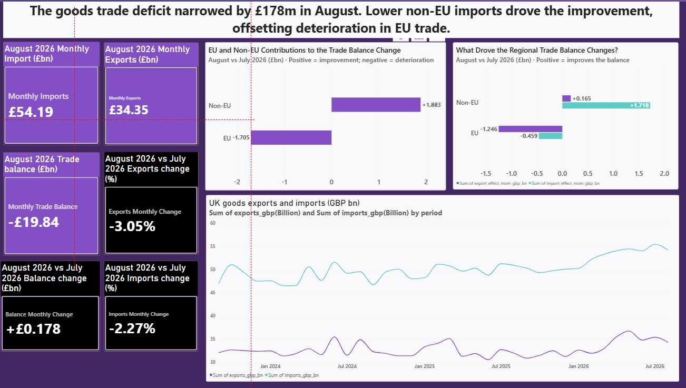

# UK Goods Trade Performance

### Monthly trends and EU / Non-EU contributions | September 2023–August 2026

A data analysis portfolio project using **Python, Google Colab, DAX and Power BI** to explain UK goods trade trends and the regional movements behind the latest monthly trade balance.

**Headline finding:** The UK goods deficit narrowed by **£178 million in August 2026**. Improvement in non-EU trade, mainly from lower imports, outweighed deterioration in EU trade. Overall exports still fell compared with July.

## View the report

**GitHub Page:** [UK Trade Performance](https://bboinnovate20.github.io/uk-goods-trade/). The page shows the report content only: the August 2026 cards, the EU and non-EU contribution charts, the export and import trend, and the detail table.

**Power BI file:** [UK Trade Performance.pbix](UK%20Trade%20Performance.pbix). Open this file in Power BI Desktop. A `.pbix` file cannot run inside a browser, so the page uses the same validated figures as the report instead of a Power BI web link.

The report is a fixed **August 2026 snapshot**, not a live connection to ONS.

## Research question

**How has UK goods trade changed over time, and how did EU and non-EU trade contribute to the change in the trade balance in August 2026?**

Supporting questions:

1. What were exports, imports and the trade balance in the latest available month?
2. How did they change compared with the previous month?
3. Which region contributed to improvement or deterioration in the balance?
4. Were those regional movements associated with changes in exports or imports?
5. How does the latest month compare with the longer-term pattern?

## Project overview

I prepared and analysed Office for National Statistics (ONS) monthly goods trade data, then developed a Power BI report to communicate the findings to UK business leaders. The workflow covers defining the analytical question, selecting relevant series, cleaning and reshaping data, validating totals, calculating indicators, exploring trends and presenting findings.

The report provides national trade context for discussions about export markets and sourcing. Company-level sales and purchasing data would be needed to assess a particular business's exposure.

## Data and scope

| Item | Coverage |
|---|---|
| Source | ONS UK trade bulletin and MRET time series |
| Source release | 15 October 2026 |
| Dashboard period | September 2023–August 2026: 36 months |
| Preparation window | September 2022–August 2026, retaining a 12-month baseline for annual comparisons |
| Markets | Worldwide Total, EU and Non-EU |
| Scope | Goods excluding precious metals, including non-monetary gold |
| Basis | Balance of payments; seasonally adjusted; current prices |
| Units | Source values in £million, converted to £billion for Power BI |

Sources: [ONS UK trade: August 2026](https://www.ons.gov.uk/economy/nationalaccounts/balanceofpayments/bulletins/uktrade/august2026) · [ONS MRET dataset](https://www.ons.gov.uk/economy/nationalaccounts/balanceofpayments/datasets/tradeingoodsmretsallbopeu2013timeseriesspreadsheet)

The selected series are FSIK / FSIH / FSIE for worldwide exports / imports / balance; FSL4 / FSL5 / FSL6 for EU; and FSL7 / FSL8 / FSL9 for Non-EU.

## Preparation and validation

- Selected nine relevant series and retained monthly records, excluding annual and quarterly observations.
- Parsed dates and numbers, preserved missing values, and retained the source release date.
- Reshaped the data to one row per month and market.
- Checked duplicate keys, calendar coverage and numeric completeness.
- Reconciled **exports − imports = trade balance**, and **EU + Non-EU = Worldwide** for each flow.
- Calculated monthly and annual changes using calendar-matched comparison periods; unavailable or zero denominators do not produce misleading growth rates.
- Calculated regional shares and signed contributions to changes in the trade balance.
- Created separate Power BI imports: **Worldwide** with 36 rows and **Regions** with 72 rows.

All recorded preparation, KPI and contribution validation checks returned **zero issues**. Check outputs are included below.

**Avoiding double counting:** Worldwide already contains EU and Non-EU. Worldwide totals are analysed separately; regional comparisons use EU and Non-EU only.

## KPI definitions

| KPI | Calculation | Display |
|---|---|---|
| Monthly exports / imports | Value for the reporting month | £bn |
| Monthly trade balance | Exports − imports | £bn |
| Export / import monthly change | (Current month − previous month) ÷ previous month | % |
| Balance monthly change | Current balance − previous balance | £bn, not % |
| Export contribution | Current exports − previous exports | £bn |
| Import contribution | Previous imports − current imports | £bn |
| Regional share | Regional flow ÷ worldwide flow for the same month | % |

Export contribution + import contribution = change in the trade balance. Positive contributions improve the balance; negative contributions worsen it. An improvement can mean a smaller deficit rather than a surplus.

Headline DAX measures use the latest date within the current filter context. Regional charts use `is_latest_month = 1` to show the latest month in the imported snapshot. These approaches are appropriate for this fixed snapshot; a future date slicer would require consistent date handling across all visuals.

Power BI fields ending in `_rate` store fractions for native percentage formatting. Fields ending in `_gbp_bn` already contain billions and must not be scaled to billions a second time.

## Key findings

### Latest month: August 2026 compared with July 2026

| Indicator | August value | Change from July |
|---|---:|---:|
| Goods exports | £34.352bn | −3.05% |
| Goods imports | £54.191bn | −2.27% |
| Goods trade balance | −£19.839bn | +£0.178bn |

Imports fell by **£1.259bn**, while exports fell by **£1.081bn**. The larger fall in imports in cash terms explains the **£0.178bn narrowing of the deficit**, despite the larger percentage fall in exports.

### Regional contributions

| Region | Export contribution | Import contribution | Balance change |
|---|---:|---:|---:|
| EU | −£1.246bn | −£0.459bn | −£1.705bn |
| Non-EU | +£0.165bn | +£1.718bn | +£1.883bn |
| Worldwide reconciliation | −£1.081bn | +£1.259bn | +£0.178bn |

The EU deficit widened because exports fell and imports rose. The non-EU deficit narrowed mainly because imports fell. These opposing movements explain the modest improvement in the worldwide balance.

### Longer-term context from the supporting analysis

- The UK recorded a goods trade deficit in **all 36 months** of the dashboard window.
- The June–August 2026 deficit was **£59.055bn**, compared with **£56.604bn** in March–May: a **£2.451bn widening**.
- August's monthly improvement therefore does not establish a sustained improvement in trade performance.

The three-month results are supporting notebook analysis; they are not additional KPI cards on the current report page.

## Business interpretation

The dashboard helps distinguish a narrowing deficit driven by lower imports from one driven by stronger exports. In August, the former dominated. This is useful context for further investigation, but it does not establish the cause of lower imports or the performance of individual firms.

A useful next step would be to examine commodity and partner-country data, then compare those patterns with a business's own supplier spending and export sales before recommending commercial action.

## Repository contents

The relative links below assume this README and the accompanying files are uploaded together, preserving the folder structure.

| File | Purpose |
|---|---|
| [Analysis notebook](uk_trade_colab_starter.ipynb) | Preparation, KPI calculations and exploratory analysis |
| [KPI definitions and data dictionary](uk_trade_kpis_and_data_dictionary.md) | Field definitions and analytical scope |
| [Prepared monthly data](uk_trade_monthly_prepared.csv) | Validated monthly observations including the comparison baseline |
| [KPI dataset](uk_trade_dashboard.csv) | Derived indicators for the reporting window |
| [Series metadata](uk_trade_series_metadata.csv) | Selected source series and metadata |
| [Regional contributions](uk_trade_regional_contributions.csv) | Evidence for monthly and period comparisons |
| [Preparation checks](uk_trade_preparation_checks.csv) | Source and preparation validation results |
| [KPI checks](uk_trade_kpi_checks.csv) | Indicator validation results |
| [Analysis checks](uk_trade_analysis_checks.csv) | Contribution reconciliation results |
| [Worldwide Power BI data](powerbi/Worldwide.csv) | Worldwide monthly data in report-ready units |
| [Regional Power BI data](powerbi/Regions.csv) | EU and Non-EU monthly data in report-ready units |
| [DAX measures](powerbi/Measures.dax) | Reporting-month KPIs, dynamic titles and formatting guidance |
| [Power BI report](UK%20Trade%20Performance.pbix) | UK Trade Performance report. Open it in Power BI Desktop. |

## Reproducing the analysis

1. Open the notebook in Google Colab and supply the ONS MRET CSV. Adjust the input path if needed.
2. Run the preparation, validation, KPI and analysis cells in order. For the same numerical results, use the **15 October 2026 release vintage**; later releases may revise historical figures.
3. Inspect the validation outputs before interpreting or visualising the data.
4. Import `powerbi/Worldwide.csv` and `powerbi/Regions.csv` into Power BI Desktop. Set dates to Date, value fields to numeric types, and rates to Percentage format.
5. Use the reporting-month measures for cards and the latest-month filter for the regional contribution charts. Keep the historical line chart across the full display period.

The notebook may contain session-specific file paths. A fresh ONS download is not guaranteed to reproduce this historical snapshot exactly.

## Limitations

- These are **goods-only** statistics, not the overall goods-and-services trade balance.
- Current-price changes combine price and quantity effects; they do not measure real trade-volume growth.
- The regional decomposition is arithmetic, not evidence of causes such as tariffs, exchange rates or demand changes.
- National trade shares do not measure an individual company's sourcing or revenue exposure.
- ONS may revise historical estimates. The report is a fixed release snapshot with no automatic refresh configured.

## Skills demonstrated

Research-question development · data cleaning and reshaping · time-series analysis · data-quality validation · KPI design · DAX measures · Power BI visualisation · business interpretation · documentation

## GitHub Page

`index.html` is the GitHub Page. It shows the August 2026 report figures and the detail table, with no site navigation. Publishing steps are in [DEPLOYMENT.md](DEPLOYMENT.md).
